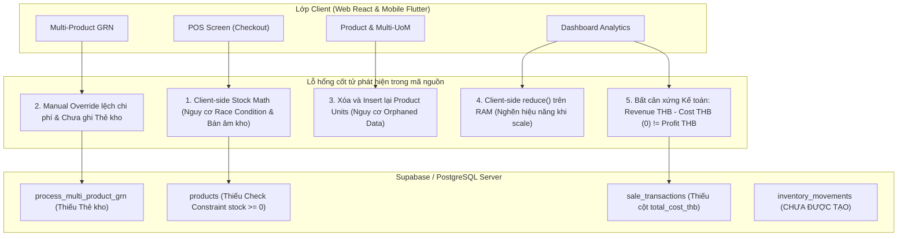
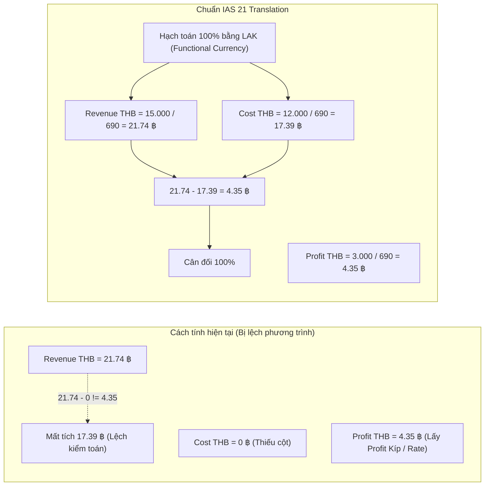
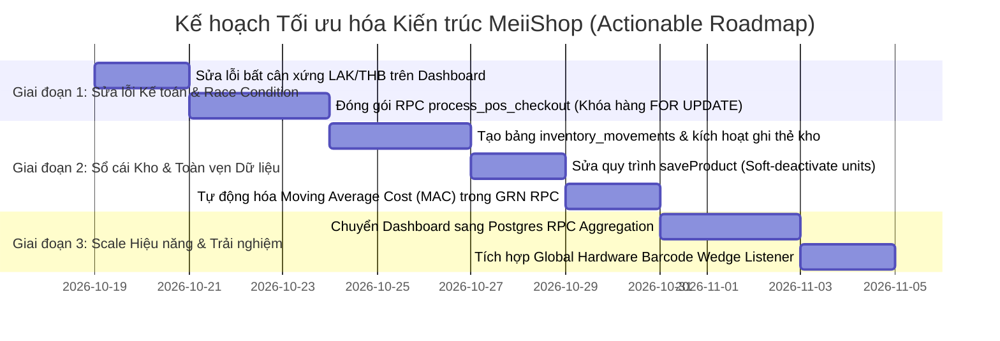

# BÁO CÁO KIỂM TOÁN KIẾN TRÚC & MÃ NGUỒN TOÀN DIỆN
## HỆ THỐNG BÁN LẺ & ERP NGUYÊN TỬ MEIISHOP CLOUD POS (CHDCND LÀO)

> **Cơ quan kiểm toán kiến trúc:** Principal Enterprise Solutions Architect & Chief Financial Auditor  
> **Hệ quy chiếu chuẩn mực:** IFRS / IAS 2 (Hàng tồn kho), IAS 21 (Kế toán ngoại tệ), Best Practices Odoo ERP & SAP Retail  
> **Phiên bản hệ thống:** MeiiShop 2.0 (Dual-currency LAK & THB, Point-in-Time Snapshot, Multi-unit UoM)  
> **Ngày lập báo cáo:** 18/10/2026  

---

## MỤC LỤC
1. [TỔNG QUAN KIẾN TRÚC & TÓM TẮT ĐIỀU HÀNH (EXECUTIVE SUMMARY)](#1-tổng-quan-kiến-trúc--tóm-tắt-điều-hành)
2. [PHẦN 1: KIỂM TOÁN 5 PHÂN HỆ CỐT LÕI (MODULE-BY-MODULE AUDIT)](#phần-1-kiểm-toán-5-phân-hệ-cốt-lõi)
   - [1.1. Phân hệ Sản phẩm & Đa cấp đơn vị (Product & Multi-unit UoM)](#11-phân-hệ-sản-phẩm--đa-cấp-đơn-vị)
   - [1.2. Phân hệ Nhập kho nhiều sản phẩm (Multi-Product GRN & AP Debt)](#12-phân-hệ-nhập-kho-nhiều-sản-phẩm)
   - [1.3. Phân hệ Bán hàng tại quầy (POS Screen & Checkout)](#13-phân-hệ-bán-hàng-tại-quầy)
   - [1.4. Phân hệ Sổ cái & Lịch sử giao dịch (Inventory Ledger & History Log)](#14-phân-hệ-sổ-cái--lịch-sử-giao-dịch)
   - [1.5. Phân hệ Báo cáo Tài chính & Tổng quan (Dashboard Analytics)](#15-phân-hệ-báo-cáo-tài-chính--tổng-quan)
3. [PHẦN 2: CHẤT VẤN CHUYÊN SÂU: RỦI RO KẾ TOÁN LÃI/LỖ ĐA TIỀN TỆ](#phần-2-chất-vấn-chuyên-sâu-rủi-ro-kế-toán-lãilỗ-đa-tiền-tệ)
   - [2.1. Phân tích lỗ hổng cho sản phẩm nội địa (Không có giá Baht)](#21-phân-tích-lỗ-hổng-cho-sản-phẩm-nội-địa)
   - [2.2. Vị trí mã nguồn phát sinh lỗi bất đối xứng kế toán](#22-vị-trí-mã-nguồn-phát-sinh-lỗi-bất-đối-xứng-kế-toán)
   - [2.3. Thuật toán & Công thức chuẩn mực quốc tế (IAS 21 Presentation)](#23-thuật-toán--công-thức-chuẩn-mực-quốc-tế)
4. [PHẦN 3: ĐÁNH GIÁ TỔNG KẾT & LỘ TRÌNH TỐI ƯU HÓA (ROADMAP)](#phần-3-đánh-giá-tổng-kết--lộ-trình-tối-ưu-hóa)
   - [3.1. Bảng phân loại Nợ kỹ thuật (Technical Debt Scorecard)](#31-bảng-phân-loại-nợ-kỹ-thuật)
   - [3.2. Đánh giá Định giá tồn kho: Last Purchase Cost vs Moving Average Cost (MAC)](#32-đánh-giá-định-giá-tồn-kho)
   - [3.3. Kế hoạch hành động cụ thể (Actionable Next Steps)](#33-kế-hoạch-hành-động-cụ-thể)

---

## 1. TỔNG QUAN KIẾN TRÚC & TÓM TẮT ĐIỀU HÀNH

Hệ thống MeiiShop đã đạt được những bước tiến quan trọng về tính linh hoạt bán lẻ (Đa mức giá Price Tiers, Đơn vị quy đổi Thùng/Pack/Lẻ, Point-in-time Snapshot tỷ giá, hàm RPC nhập kho nhiều sản phẩm). Tuy nhiên, dưới góc nhìn kiểm toán doanh nghiệp (Enterprise Architecture & Financial Audit), hệ thống đang tồn tại **4 lỗ hổng kiến trúc mang tính sống còn** đe dọa sự ổn định khi mở rộng quy mô:



---

## PHẦN 1: KIỂM TOÁN 5 PHÂN HỆ CỐT LÕI

### 1.1. Phân hệ Sản phẩm & Đa cấp đơn vị (Product & Multi-unit UoM)

#### A. Tính toàn vẹn của mô hình quan hệ (`products` & `product_units`)
- **Cấu trúc hiện tại:** Bảng `product_units` có khóa ngoại `product_id REFERENCES products(id) ON DELETE CASCADE` ([supabase_schema.sql:L24](file:///c:/Users/thayz/OneDrive/Desktop/MeiiShop/supabase_schema.sql#L24)).
- **Lỗ hổng Anti-pattern:** Tại [web-app/src/services/supabase.js:L398-L428](file:///c:/Users/thayz/OneDrive/Desktop/MeiiShop/web-app/src/services/supabase.js#L398-L428), khi người dùng lưu chỉnh sửa sản phẩm:
  ```javascript
  // BƯỚC 1: Xóa sạch toàn bộ đơn vị cũ của sản phẩm
  await supabase.from('product_units').delete().eq('product_id', product.id);
  // BƯỚC 2: Insert lại mảng đơn vị mới
  await supabase.from('product_units').insert(unitsPayload);
  ```
- **Hệ quả rủi ro:**
  1. **Foreign Key Violation:** Nếu các bảng giao dịch (`sale_transaction_items`, `purchase_order_items`) có Foreign Key trỏ vào `product_units(id)`, lệnh `DELETE` này sẽ bị PostgreSQL từ chối thực thi với mã lỗi 500 (`violates foreign key constraint`).
  2. **Orphaned Data:** Do bảng `sale_transaction_items` hiện không tạo khóa ngoại trỏ vào `product_units`, việc xóa và sinh mới lại `unit_id` làm cho toàn bộ lịch sử bán hàng bị đứt gãy quan hệ với đơn vị tính chuẩn ban đầu.
- **Giải pháp chuẩn hóa (ERP Standard):** Tuyệt đối không xóa vật lý (`DELETE`). Áp dụng cơ chế **Soft-deactivate** (`is_active BOOLEAN DEFAULT TRUE`) hoặc **UoM Upsert** theo ID cố định (`${product_id}_carton`, `${product_id}_pack`, `${product_id}_piece`).

#### B. Cơ chế tính `cost_per_base_unit` & Rủi ro làm tròn số lẻ (Rounding Drift)
- Tại [web-app/src/App.jsx:L1020](file:///c:/Users/thayz/OneDrive/Desktop/MeiiShop/web-app/src/App.jsx#L1020):
  ```javascript
  if (tier1Multiplier > 0) {
    costPerBaseUnit = Math.round(costKip / tier1Multiplier);
  }
  ```
- **Phân tích sai số kế toán:** Giả sử nhập 1 thùng bia gồm 24 lon với giá vốn 350.000 LAK:
  $$\text{Đơn giá 1 lon} = \frac{350.000}{24} = 14.583,3333... \text{ LAK} \xrightarrow{\text{Math.round()}} 14.583 \text{ LAK}$$
  Khi bán hết 1 thùng (24 lon):
  $$\text{Giá vốn xuất kho ghi nhận} = 14.583 \times 24 = 349.992 \text{ LAK} \neq 350.000 \text{ LAK}$$
  Thất thoát **8 LAK/thùng**. Bán 10.000 thùng làm thất thoát lũy kế **80.000 LAK** trên sổ sách.
- **Giải pháp chuẩn hóa:** Lưu `cost_per_base_unit` dưới dạng kiểu dữ liệu số thực chính xác cao `NUMERIC(18, 4)` trong PostgreSQL thay vì làm tròn số nguyên (`BIGINT`) quá sớm.

---

### 1.2. Phân hệ Nhập kho nhiều sản phẩm (Multi-Product GRN & AP Debt)

#### A. Độ an toàn của RPC `process_multi_product_grn`
- **Điểm mạnh:** Hàm RPC tại [migration_process_multi_product_grn_rpc.sql:L95-L351](file:///c:/Users/thayz/OneDrive/Desktop/MeiiShop/migration_process_multi_product_grn_rpc.sql#L95-L351) đã đạt tiêu chuẩn giao dịch nguyên tử (ACID). Toàn bộ thao tác thêm Header, Items, cộng kho và ghi nợ được bao bọc trong transaction block có `EXCEPTION WHEN OTHERS THEN RAISE`.
- **Lỗ hổng cốt tử:** **Hàm RPC hoàn toàn chưa ghi nhận Thẻ kho (`inventory_movements`)!** Kho chỉ được cộng dồn vào con số snapshot `products.current_stock_base_units`. Khi kiểm toán cần kiểm tra nguồn gốc số lượng tồn kho (Ngày nào nhập, số phiếu nào, do ai duyệt), hệ thống không có nhật ký thẻ kho để đối soát.

#### B. Bài toán "Sửa đè Tổng tiền phiếu nhập" (Manual Override Total)
- **Hiện trạng:** Khi người dùng nhập tổng tiền ở Card 4 khác với tổng cộng dồn từng dòng (ví dụ: Nhà cung cấp bớt 50.000 LAK hoặc thu thêm 30.000 LAK phí vận chuyển):
  - Giá trị sửa đè được lưu vào `purchase_orders.total_cost_lak`.
  - Nhưng trong bảng chi tiết `purchase_order_items` và giá vốn `products.cost_per_base_unit`, hệ thống vẫn lấy đơn giá chưa chiết khấu/chưa cộng phí!
- **Hệ quả Kế toán:** 
  $$\sum \text{purchase\_order\_items.line\_total\_lak} \neq \text{purchase\_orders.total\_cost\_lak}$$
  Dẫn đến **lệch sổ kế toán giữa Công nợ phải trả (AP) và Giá trị hàng tồn kho (Inventory Valuation)**.
- **Giải pháp chuẩn mực quốc tế (Landed Cost & Prorated Allocation):**
  1. **Phương pháp Phân bổ tỷ lệ (Prorated Allocation):** Hệ thống phải tự động tính hệ số chênh lệch:
     $$k = \frac{\text{Manual Total LAK}}{\text{Auto Sum LAK}}$$
     Sau đó tự động nhân hệ số $k$ này vào `cost_per_base_unit` của từng dòng sản phẩm trong phiếu nhập trước khi commit vào kho.
  2. **Phương pháp Phân loại chi phí (Variance Account):** Nếu khoản chênh lệch là chiết khấu thương mại, ghi nhận vào tài khoản `Chiết khấu mua hàng`. Nếu là cước xe/bốc xếp, tạo dòng chi phí `Landed Cost` để phân bổ vào giá vốn sản phẩm theo trọng số giá trị.

---

### 1.3. Phân hệ Bán hàng tại quầy (POS Screen & Checkout)

#### A. Trừ kho khi in bill: Race Condition & Lỗ hổng Client-side Stock Math
- **Hiện trạng mã nguồn:** Tại [web-app/src/services/supabase.js:L740-L754](file:///c:/Users/thayz/OneDrive/Desktop/MeiiShop/web-app/src/services/supabase.js#L740-L754):
  ```javascript
  if (stockDeductions && stockDeductions.length > 0) {
    for (const d of stockDeductions) {
      await supabase.from('products').update({
        current_stock_base_units: d.newStock // <-- Client tự tính newStock!
      }).eq('id', d.productId);
    }
  }
  ```
- **Nguy cơ cực kỳ nghiêm trọng:**
  1. **Không có Khóa dòng (Row-level Locking) và không có RPC nguyên tử:** Toàn bộ phép tính trừ kho chạy trên trình duyệt thu ngân (`newStock = currentStock - quantity`).
  2. **Kịch bản Race Condition (Bán âm hàng):** Còn đúng 1 lon bia cuối cùng. Thu ngân A và Thu ngân B cùng quét thanh toán tại mili-giây thứ 10:
     - Máy A đọc tồn kho = 1 $\rightarrow$ tính `newStock = 0` $\rightarrow$ gửi `UPDATE products SET current_stock = 0`.
     - Máy B đọc tồn kho = 1 $\rightarrow$ tính `newStock = 0` $\rightarrow$ gửi `UPDATE products SET current_stock = 0`.
     - Kết quả: **2 khách hàng cùng cầm 2 lon bia ra về (trong khi thực tế cửa hàng chỉ có 1)**. Tồn kho hiển thị 0 thay vì -1 hoặc chặn thu ngân thứ 2.
  3. **Thiếu Database Constraint:** Bảng `products` không có ràng buộc `CHECK (current_stock_base_units >= 0)`.
- **Yêu cầu chuẩn Enterprise:** Bắt buộc đóng gói RPC `process_pos_checkout(payload JSONB)` thực hiện `SELECT ... FOR UPDATE` từng sản phẩm và trừ kho nguyên tử trên Postgres:
  ```sql
  UPDATE public.products 
  SET current_stock_base_units = current_stock_base_units - v_qty_sold
  WHERE id = v_prod_id AND current_stock_base_units >= v_qty_sold;
  ```

#### B. Cơ chế quét mã vạch Barcode (Hardware Scanner Integration)
- **Điểm yếu trên Web:** Tại [web-app/src/components/PosScreen.jsx:L103 & L729](file:///c:/Users/thayz/OneDrive/Desktop/MeiiShop/web-app/src/components/PosScreen.jsx#L103), sự kiện quét mã vạch chỉ gắn vào `onKeyDown` của duy nhất một thẻ `<input>` tìm kiếm.
  - Nếu thu ngân vô tình click chuột ra ngoài vùng input (ví dụ click vào bảng giỏ hàng hoặc ô Tên khách hàng), việc bấm máy quét USB sẽ gõ thẳng chuỗi số mã vạch vào ô Tên khách hàng hoặc không có phản hồi gì.
- **Chuẩn hóa:** Cần thiết lập **Global Keydown Wedge Listener** trên thẻ `window`:
  - Máy quét phần cứng (USB/Bluetooth) gõ các ký tự với khoảng cách cực ngắn (delta time giữa 2 phím $< 30\text{ms}$), kết thúc bằng ký tự `Enter` (`\n`).
  - Nếu phát hiện tốc độ nhập $< 30\text{ms}$, hệ thống tự động intercept chuỗi, hủy bubbling để không làm nhiễu ô input khác, và nạp thẳng sản phẩm vào giỏ hàng.

#### C. Thanh toán tiền mặt đa tiền tệ & Làm tròn tiền (Cash Rounding)
- Tại [web-app/src/components/CheckoutModal.jsx:L252-L298](file:///c:/Users/thayz/OneDrive/Desktop/MeiiShop/web-app/src/components/CheckoutModal.jsx#L252-L298), ô nhận tiền chỉ cho phép nhập Kip (`tenderedKip`). Không có trường chuyên dụng để nhập `tendered_thb`, `exchange_rate_applied`, và thuật toán làm tròn tiền thối (Cash Rounding) theo mệnh giá tiền thực tế tại Lào (500 LAK, 1.000 LAK).

---

### 1.4. Phân hệ Sổ cái & Lịch sử giao dịch (Inventory Ledger & History Log)

#### A. Tình trạng bảng Thẻ kho `inventory_movements`
- **Kết quả rà soát:** Bảng `inventory_movements` **chưa tồn tại trong mã nguồn**. Hệ thống MeiiShop hiện hoạt động hoàn toàn theo cơ chế "State-based" (chỉ lưu số dư cuối kỳ) thay vì "Ledger-based" (Event-sourcing - Sổ cái biến động).
- **Yêu cầu bắt buộc của ERP:** Phải tạo bảng `inventory_movements` bao quát 5 loại biến động kho:
  1. `IN_PURCHASE`: Nhập hàng từ nhà cung cấp.
  2. `OUT_SALE`: Xuất kho bán hàng tại quầy POS.
  3. `IN_SALE_RETURN`: Khách trả hàng (hoàn kho).
  4. `OUT_PURCHASE_RETURN`: Xuất trả hàng lại cho nhà cung cấp.
  5. `ADJUSTMENT`: Kiểm kê thừa/thiếu định kỳ.

#### B. Quy trình Hủy/Sửa giao dịch (Void Transaction)
- Tại [web-app/src/services/supabase.js:L773](file:///c:/Users/thayz/OneDrive/Desktop/MeiiShop/web-app/src/services/supabase.js#L773):
  ```javascript
  const cancelledPaymentMethod = `cancelled:${originalPaymentMethod || 'cash'}`;
  await supabase.from('sale_transactions').update({
    payment_method: cancelledPaymentMethod
  }).eq('id', txId);
  ```
- **Đánh giá nghiệp vụ:** Nhồi nhét trạng thái hủy vào trường `payment_method` là một Anti-pattern. Bảng `sale_transactions` cần có cột `status TEXT NOT NULL DEFAULT 'COMPLETED' CHECK (status IN ('COMPLETED', 'VOIDED', 'REFUNDED'))`, cùng các trường kiểm toán `voided_at`, `voided_by`, `void_reason`.

---

### 1.5. Phân hệ Báo cáo Tài chính & Tổng quan (Dashboard Analytics)

#### A. Hiệu năng tính toán Client-side `reduce()`
- Tại [web-app/src/App.jsx:L2003-L2008](file:///c:/Users/thayz/OneDrive/Desktop/MeiiShop/web-app/src/App.jsx#L2003-L2008) và [DashboardView.jsx:L98-L112](file:///c:/Users/thayz/OneDrive/Desktop/MeiiShop/web-app/src/components/DashboardView.jsx#L98-L112):
  ```javascript
  const totalRevenueLak = currentTxs.reduce((sum, order) => sum + Number(order.total_lak ?? order.grandTotal ?? 0), 0);
  const totalProfitLak = currentTxs.reduce((sum, order) => sum + Number(order.gross_profit_lak ?? order.grossProfit ?? 0), 0);
  ```
- **Hạn chế khi scale:**
  - Khi cửa hàng hoạt động 6 tháng - 1 năm, số lượng hóa đơn chạm mốc $20.000 - 100.000$ đơn hàng.
  - Trình duyệt/App iPad sẽ phải tải toàn bộ mảng dữ liệu nặng hàng chục Megabytes từ Supabase qua mạng Internet, sau đó ép CPU chạy vòng lặp `reduce()` trên bộ nhớ RAM.
  - Dẫn đến tình trạng **đơ giao diện, sụt khung hình (UI lag) và cạn kiệt bộ nhớ (Crash/Out of Memory)**.
- **Giải pháp chuyển đổi:** Đẩy $100\%$ việc tính toán về Database Server thông qua SQL Aggregate Views hoặc RPC tổng hợp theo ngày/tháng:
  ```sql
  CREATE OR REPLACE FUNCTION get_dashboard_kpis(p_start TIMESTAMPTZ, p_end TIMESTAMPTZ)
  RETURNS JSONB AS $$
    SELECT json_build_object(
      'total_revenue_lak', COALESCE(SUM(total_lak), 0),
      'total_profit_lak', COALESCE(SUM(gross_profit_lak), 0),
      'tx_count', COUNT(id)
    )
    FROM sale_transactions
    WHERE created_at BETWEEN p_start AND p_end AND status = 'COMPLETED';
  $$ LANGUAGE sql STABLE;
  ```

---

## PHẦN 2: CHẤT VẤN CHUYÊN SÂU: RỦI RO KẾ TOÁN LÃI/LỖ ĐA TIỀN TỆ

### TÌNH HUỐNG: SẢN PHẨM NỘI ĐỊA LÀO (KHÔNG CÓ GIÁ VỐN THB)

Các mặt hàng như Bia Lào (Beerlao), nước đá, rau củ địa phương được mua bằng LAK, `cost_thb = 0` hoặc `NULL`.



---

### 2.1. Phân tích 3 Sai lệch Nghiêm trọng trong mã nguồn hiện tại

#### Sai lệch 1: Bất đối xứng Doanh thu - Giá vốn - Lợi nhuận (Equation Breakdown)
- Trong [web-app/src/components/DashboardView.jsx:L99-L112](file:///c:/Users/thayz/OneDrive/Desktop/MeiiShop/web-app/src/components/DashboardView.jsx#L99-L112):
  - `totalRevenueThb` cộng dồn từ `order.total_thb` (vốn được sinh ra từ `totalLak / currentRate`).
  - `totalCostThb` cộng dồn từ `order.total_cost_thb` $\rightarrow$ **Cột này KHÔNG hề tồn tại trong bảng `sale_transactions`**, kết quả là `totalCostThb` luôn bằng `0`!
  - `totalProfitThb` cộng dồn từ `order.gross_profit_thb` (vốn được sinh ra từ `grossProfitLak / currentRate`).
- **Kịch bản số liệu thực tế:** Khách mua 1 chai bia giá bán 15.000 LAK, giá vốn 12.000 LAK, lãi 3.000 LAK. Tỷ giá 690:
  - Doanh thu THB hiển thị: $\frac{15.000}{690} = 21,74 \text{ ฿}$
  - Giá vốn THB hiển thị: $0 \text{ ฿}$
  - Lợi nhuận gộp THB hiển thị: $\frac{3.000}{690} = 4,35 \text{ ฿}$
  - **Phát hiện kiểm toán:** $\text{Doanh thu } (21,74 \text{ ฿}) - \text{Giá vốn } (0 \text{ ฿}) = 21,74 \text{ ฿} \neq 4,35 \text{ ฿}$! Hệ thống làm "bốc hơi" $17,39 \text{ ฿}$ khỏi báo cáo tài chính.

#### Sai lệch 2: Ghi nhận Doanh thu Ngoại tệ ảo (Ghost Foreign Revenue)
- Khách hàng trả bằng tiền Kíp, mua sản phẩm nội địa thanh toán cho nhà máy bia bằng tiền Kíp. Việc hệ thống tự động ghi nhận doanh thu 21,74 THB khiến chủ cửa hàng hiểu lầm rằng quỹ tiền Baht của mình đang tăng lên, trong khi thực tế tài khoản/két sắt Baht không có biến động.

#### Sai lệch 3: Rủi ro chia cho 0 (`NaN` / `Infinity`)
- Tại [web-app/src/App.jsx:L2004-L2008](file:///c:/Users/thayz/OneDrive/Desktop/MeiiShop/web-app/src/App.jsx#L2004-L2008), các phép tính chia trực tiếp cho `order.exchange_rate` nếu gặp đơn hàng cũ lưu rate = 0 sẽ sinh ra giá trị `Infinity` hoặc `NaN`, làm gãy toàn bộ biểu đồ Chart.js và giao diện số liệu.

---

### 2.2. Vị trí mã nguồn phát sinh lỗi bất đối xứng kế toán

1. **[web-app/src/App.jsx:L1442-L1483](file:///c:/Users/thayz/OneDrive/Desktop/MeiiShop/web-app/src/App.jsx#L1442-L1483):**
   - Khi tạo đối tượng `receipt`, mã nguồn tính `total_thb` và `gross_profit_thb` nhưng **bỏ quên `total_cost_thb`**.
2. **[supabase_schema.sql](file:///c:/Users/thayz/OneDrive/Desktop/MeiiShop/supabase_schema.sql) & [migration_exchange_rate_and_point_in_time_snapshot.sql](file:///c:/Users/thayz/OneDrive/Desktop/MeiiShop/migration_exchange_rate_and_point_in_time_snapshot.sql):**
   - Bảng `sale_transactions` thiếu cột `total_cost_thb NUMERIC DEFAULT 0`.
3. **[web-app/src/components/DashboardView.jsx:L104-L107](file:///c:/Users/thayz/OneDrive/Desktop/MeiiShop/web-app/src/components/DashboardView.jsx#L104-L107):**
   - `order.total_cost_thb ?? order.totalCostThb ?? 0` luôn rơi vào fallback `0`.

---

### 2.3. Thuật toán & Công thức Chuẩn Mực Quốc Tế (IAS 21 Presentation)

Hệ thống ERP chuyên nghiệp tuân thủ nguyên tắc: **Tách biệt Đồng tiền Hạch toán cơ sở (Functional Currency) và Đồng tiền Trình bày báo cáo (Presentation/Reporting Currency)**.

#### Bước 1: Hạch toán gốc duy nhất bằng LAK (Functional Currency)
Toàn bộ sản phẩm (dù nhập bằng Baht hay Kíp) khi vào kho đều được quy đổi về **Giá vốn Kíp cơ sở (Base LAK Cost)** tại thời điểm nhập:
- Hàng nội địa: $\text{Base Cost LAK} = \text{cost\_lak}$.
- Hàng nhập khẩu: $\text{Base Cost LAK} = \text{cost\_thb} \times \text{Spot Rate}_{\text{GRN}}$.
- Khi bán hàng, lợi nhuận gộp **bắt buộc tính bằng LAK trước**:
  $$\text{Gross Profit (LAK)} = \text{Line Total (LAK)} - (\text{Base Cost LAK} \times \text{Quantity})$$

#### Bước 2: Báo cáo quy đổi THB chuẩn mực (Translation Method)
Khi chủ cửa hàng muốn xem báo cáo quy đổi sang THB, toàn bộ các chỉ tiêu Doanh thu, Giá vốn và Lợi nhuận phải được quy đổi đồng nhất theo tỷ giá Snapshot của từng đơn hàng:

$$\text{Translated Revenue (THB)} = \sum \frac{\text{Order Total LAK}}{\text{Snapshot Exchange Rate}}$$
$$\text{Translated COGS (THB)} = \sum \frac{\text{Order Cost LAK}}{\text{Snapshot Exchange Rate}}$$
$$\text{Translated Gross Profit (THB)} = \text{Translated Revenue (THB)} - \text{Translated COGS (THB)}$$
$$\text{Gross Margin (\%)} = \left(\frac{\text{Translated Gross Profit}}{\text{Translated Revenue}}\right) \times 100\% = \left(\frac{\text{Gross Profit LAK}}{\text{Revenue LAK}}\right) \times 100\%$$

> [!IMPORTANT]
> Với công thức này, Biên lợi nhuận (%) trên tiền LAK và tiền THB luôn **trùng khớp chính xác $100\%$**, không bao giờ bị lệch phương trình Doanh thu - Giá vốn = Lợi nhuận.

---

## PHẦN 3: ĐÁNH GIÁ TỔNG KẾT & LỘ TRÌNH TỐI ƯU HÓA (ROADMAP)

### 3.1. Bảng phân loại Nợ kỹ thuật (Technical Debt Scorecard)

| Phân hệ / Tính năng | Hiện trạng kiến trúc | Đánh giá phân loại | Rủi ro tiềm ẩn khi vận hành quy mô lớn |
| :--- | :--- | :--- | :--- |
| **Multi-Price Tiers** | Lưu `price_2`, `price_3` trực tiếp trên `product_units`, dropdown compact. | **Đạt chuẩn (Acceptable)** | Không có rủi ro lớn, giao diện đã được tối ưu tinh gọn. |
| **Quy trình Lưu Sản phẩm** | Xóa toàn bộ `product_units` cũ rồi `insert` lại ([supabase.js:398](file:///c:/Users/thayz/OneDrive/Desktop/MeiiShop/web-app/src/services/supabase.js#L398)). | **Chưa chuyên nghiệp (Amateur)** | Gãy khóa ngoại (FK Violation) hoặc mồ côi dữ liệu lịch sử bán hàng/nhập hàng. |
| **Multi-Product GRN RPC** | Có RPC nguyên tử, cập nhật kho và công nợ ([migration:95](file:///c:/Users/thayz/OneDrive/Desktop/MeiiShop/migration_process_multi_product_grn_rpc.sql#L95)). | **Khá (Good)** | Chưa ghi nhận Thẻ kho `inventory_movements`; sửa đè tổng tiền chưa phân bổ tỷ lệ vào giá vốn đơn vị. |
| **Trừ kho khi Bán hàng POS** | Client tự tính `newStock` và update thẳng bảng `products` ([supabase.js:745](file:///c:/Users/thayz/OneDrive/Desktop/MeiiShop/web-app/src/services/supabase.js#L745)). | **Nguy hiểm (Unsafe / Critical)** | Trùng đơn hàng, âm kho khi 2 thu ngân cùng bán (Race Condition), không có Audit Trail. |
| **Máy quét mã vạch (Scanner)** | Chỉ bắt sự kiện tại thẻ `<input>` tìm kiếm, chưa có Global Wedge Listener. | **Chưa chuyên nghiệp (Amateur)** | Thu ngân bấm lệch chuột ra ngoài ô tìm kiếm thì máy quét không hoạt động hoặc gõ nhầm vào ô text khác. |
| **Sổ cái Thẻ kho** | Chưa có bảng `inventory_movements`. | **Thiếu hụt nghiêm trọng (Missing)** | Mất khả năng đối soát kho định kỳ, không xác định được hao hụt do đâu. |
| **Tính toán Dashboard** | Tải toàn bộ danh sách đơn hàng về Client rồi chạy `reduce()` trên RAM. | **Chậm & Nghẽn (Scalability Bottleneck)** | Tràn bộ nhớ (OOM Crash) và đơ trình duyệt khi dữ liệu vượt quá $10.000$ đơn hàng. |
| **Kế toán Song tệ (LAK/THB)** | Thiếu cột `total_cost_thb` dẫn đến `Doanh thu THB - 0 = Lợi nhuận THB`. | **Lỗi Kế toán (Accounting Flaw)** | Sai lệch toàn bộ báo cáo doanh thu, giá vốn và lãi lỗ tiền Baht. |

---

### 3.2. Đánh giá Định giá tồn kho: Last Purchase Cost vs Moving Average Cost (MAC)

#### Đánh giá phương pháp hiện tại (Last Purchase Cost - Giá nhập đợt cuối)
- **Cơ chế:** Khi có phiếu nhập kho mới, RPC ghi đè trực tiếp `cost_per_base_unit` của sản phẩm bằng giá nhập mới nhất ([migration:277](file:///c:/Users/thayz/OneDrive/Desktop/MeiiShop/migration_process_multi_product_grn_rpc.sql#L277)).
- **Nhược điểm tại Lào:** Tỷ giá THB/LAK biến động mạnh (từ 680 lên 720). Nếu tuần trước nhập 100 lon bia giá 12.000 LAK, tuần này nhập thêm 10 lon giá 13.000 LAK, toàn bộ 110 lon trong kho bị định giá vọt lên 13.000 LAK $\rightarrow$ **Thổi phồng giá trị tồn kho ảo và làm biến động gián đoạn biên lợi nhuận**.

#### Phương pháp Đề xuất: Bình quân gia quyền di động (Moving Average Cost - MAC)
- Mỗi khi có lô hàng mới nhập kho, hệ thống tự động tính lại giá vốn bình quân mới theo công thức:
  $$\text{MAC}_{\text{mới}} = \frac{(\text{Tồn hiện tại} \times \text{MAC}_{\text{hiện tại}}) + (\text{Số lượng nhập mới} \times \text{Đơn giá nhập mới})}{\text{Tồn hiện tại} + \text{Số lượng nhập mới}}$$
- **Cách triển khai không gây phức tạp cho người dùng:**
  - Người dùng vẫn thao tác nhập hàng bình thường, không cần tính toán thủ công.
  - Phép tính được tích hợp tự động ngay bên trong hàm RPC `process_multi_product_grn` trên Database Server trước khi ghi đè số tồn kho mới.

---

### 3.3. Kế hoạch hành động cụ thể (Actionable Next Steps)



#### Bước 1: Khắc phục khẩn cấp lỗi Kế toán Song tệ & Dashboard
- **File cần chỉnh sửa:** [web-app/src/App.jsx](file:///c:/Users/thayz/OneDrive/Desktop/MeiiShop/web-app/src/App.jsx), [web-app/src/components/DashboardView.jsx](file:///c:/Users/thayz/OneDrive/Desktop/MeiiShop/web-app/src/components/DashboardView.jsx), [supabase_schema.sql](file:///c:/Users/thayz/OneDrive/Desktop/MeiiShop/supabase_schema.sql).
- **Hành động:**
  1. Bổ sung cột `total_cost_thb NUMERIC DEFAULT 0` vào bảng `sale_transactions`.
  2. Khi tạo hóa đơn POS, lưu đầy đủ bộ 3 chỉ tiêu: `total_thb`, `total_cost_thb = (total_cost_lak / currentRate)`, `gross_profit_thb = total_thb - total_cost_thb`.
  3. Cập nhật `snapshotMetrics` trên `DashboardView.jsx` để bảo đảm phương trình $\text{Doanh thu} - \text{Giá vốn} = \text{Lợi nhuận}$ luôn cân đối $100\%$.

#### Bước 2: Đóng gói RPC Bán hàng POS (`process_pos_checkout`)
- **File cần chỉnh sửa:** Tạo file migration mới `migration_process_pos_checkout_rpc.sql` và sửa [web-app/src/services/supabase.js](file:///c:/Users/thayz/OneDrive/Desktop/MeiiShop/web-app/src/services/supabase.js).
- **Hành động:**
  1. Chuyển toàn bộ luồng tạo hóa đơn, trừ kho và ghi công nợ vào 1 transaction duy nhất trên Postgres.
  2. Thêm khóa dòng `SELECT current_stock_base_units FROM products WHERE id = ... FOR UPDATE` và ràng buộc `CHECK (current_stock_base_units >= 0)` để triệt tiêu vĩnh viễn nguy cơ bán âm hàng và Race Condition giữa các thu ngân.

#### Bước 3: Tạo Sổ cái Thẻ kho (`inventory_movements`) & Nâng cấp MAC
- **File cần chỉnh sửa:** `supabase_schema.sql`, `migration_process_multi_product_grn_rpc.sql`.
- **Hành động:**
  1. Tạo bảng `inventory_movements (id, product_id, movement_type, reference_id, quantity, balance_after, unit_cost, created_at)`.
  2. Kích hoạt tự động ghi nhận thẻ kho cả khi Nhập hàng (GRN) và khi Bán hàng (POS Checkout).
  3. Bổ sung công thức tính giá vốn bình quân gia quyền di động (Moving Average Cost) vào RPC nhập kho.

#### Bước 4: Tối ưu hóa hiệu năng Dashboard (Database Aggregation)
- **File cần chỉnh sửa:** [web-app/src/components/DashboardView.jsx](file:///c:/Users/thayz/OneDrive/Desktop/MeiiShop/web-app/src/components/DashboardView.jsx), [web-app/src/services/supabase.js](file:///c:/Users/thayz/OneDrive/Desktop/MeiiShop/web-app/src/services/supabase.js).
- **Hành động:**
  1. Tạo hàm RPC `get_dashboard_analytics(timeframe, start_date, end_date)` trả về trực tiếp kết quả tổng hợp dạng JSON từ Database.
  2. Client chỉ hiển thị dữ liệu đã được tổng hợp, giúp thời gian tải trang Dashboard duy trì ổn định dưới 200ms ngay cả khi dữ liệu đạt hàng triệu bản ghi.
